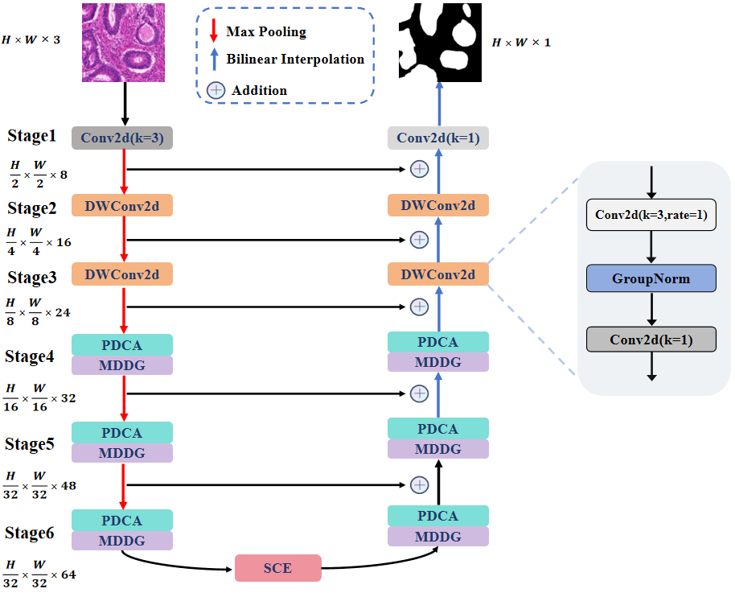

# PMS_Net

This repository is the official implementation of PMS-Net: A Lightweight Convolutional Attention U-Shaped Network for Medical Image Segmentation using PyTorch.




## Main Environments

- python 3.9
- pytorch 2.1.0
- torchvision 0.16.0
- For generating GradCAM results, please follow the code on this [repository](https://github.com/jacobgil/pytorch-grad-cam)


## Requirements

Install from the `requirements.txt` using:

```
pip install -r requirements.txt
```


## Prepare the dataset.

- The GlaS  datasets, can be found here ([link]())
- The MoNuSeg  datasets, can be found here ([link]())
- The CHASE datasets, can be found here ([link]())
- The BUSI datasets, can be found here ([link]()),
- The Chest Xray datasets, can be found here ([link]())
- The ISIC2017 datasets, can be found here ([link]())
- The Synapse datasets, can be found ([link]())


## Reference

- [TransUNet](https://github.com/Beckschen/TransUNet)

- [UCTransNet](https://github.com/McGregorWwww/UCTransNet)

- [ACC_UNet](https://github.com/qubvel/segmentation_models.pytorch)

- [UNeXt](https://github.com/jeya-maria-jose/UNeXt-pytorch)

- [DAEFormer](https://github.com/xmindflow/DAEFormer)

- [D-LKANet](https://github.com/xmindflow/deformableLKA)

- [UDTransNet]( https://github.com/McGregorWwww/UDTransNet)

- [TransCeption](https://github.com/xmindflow/TransCeption)

  ​

